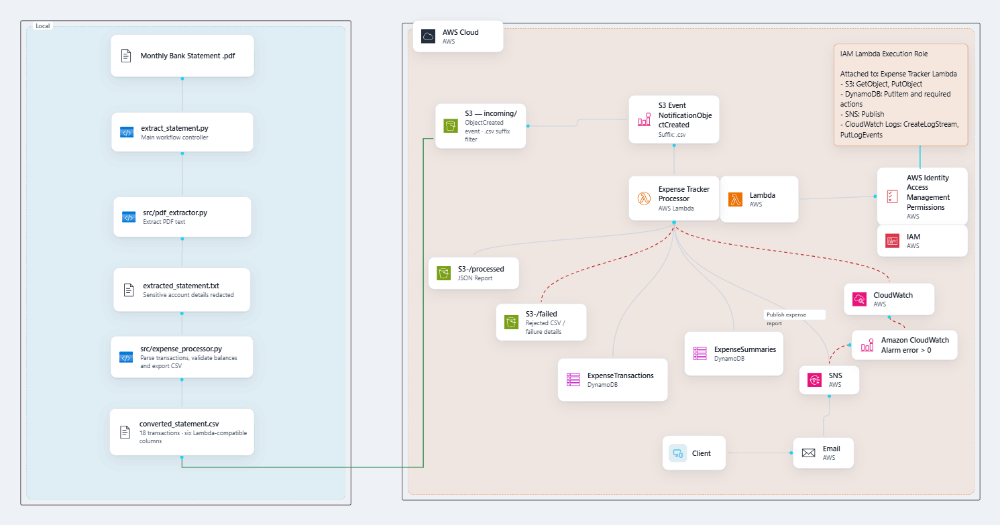

# Smart Expense Tracker – AWS Serverless Application

A serverless expense tracking application that processes monthly bank statements, extracts transaction information, categorizes expenses, stores financial records, and generates expense reports using Python and AWS services.

## 1. Project Overview

The Smart Expense Tracker automates the process of converting monthly bank statements into structured financial data.

The application uses a local Python processing pipeline to extract text from PDF bank statements, redact sensitive account information, validate transactions, and convert the extracted data into an AWS-compatible CSV file.

The generated CSV is uploaded to Amazon S3, where an S3 event notification triggers an AWS Lambda function. Lambda processes the transactions, categorizes expenses, calculates financial summaries, stores records in DynamoDB, and generates a JSON report in S3.

Amazon SNS sends expense report notifications through email, while Amazon CloudWatch monitors Lambda execution errors and triggers alarm notifications.

## 2. System Architecture



The project consists of two main components:

### A. Local Python Processing

1. The user selects a monthly bank statement PDF.
2. `extract_statement.py` controls the extraction and conversion workflow.
3. `src/pdf_extractor.py` extracts selectable text from the PDF.
4. Sensitive account information is redacted.
5. Extracted text is saved as `data/extracted_statement.txt`.
6. `src/expense_processor.py` parses the monthly summary and transaction details.
7. Financial values and running balances are validated.
8. Transactions are converted into an AWS-compatible CSV file.
9. The final CSV is saved as `data/converted_statement.csv`.

### B. AWS Serverless Processing

1. The generated CSV is uploaded to Amazon S3 under `incoming/`.
2. An S3 ObjectCreated event notification triggers the Lambda function for CSV uploads.
3. AWS Lambda validates and processes the CSV transactions.
4. Transactions are categorized and financial totals are calculated.
5. Transaction records are stored in DynamoDB.
6. Monthly summaries are stored in DynamoDB.
7. A JSON expense report is generated and saved under S3 `processed/`.
8. Amazon SNS sends the expense report through email.
9. Amazon CloudWatch monitors Lambda errors and triggers an alarm when the configured error threshold is exceeded.

## 3. Technologies Used

| Technology        | Purpose                                   |
| ----------------- | ----------------------------------------- |
| Python            | Local processing and transaction handling |
| pypdf             | PDF text extraction                       |
| CSV               | Structured transaction data               |
| Amazon S3         | Input files and generated reports         |
| AWS Lambda        | Serverless transaction processing         |
| Amazon DynamoDB   | Transaction and summary storage           |
| Amazon SNS        | Email notifications                       |
| Amazon CloudWatch | Monitoring and error alarms               |
| AWS IAM           | Access control and permissions            |

## 4. Project Structure

```text
smart-expense-tracker/
│
├── data/
│   ├── sample-statement.csv
│   ├── extracted_statement.txt
│   └── converted_statement.csv
│
├── src/
│   ├── __init__.py
│   ├── expense_processor.py
│   └── pdf_extractor.py
│
├── tests/
│   └── test_expense_process.py
│
├── backup/
│   └── lambda_original.py
│
├── extract_statement.py
├── lambda_integrated.py
├── .gitignore
└── README.md
```

_Note: The exact files in your local project may vary. Do not commit real bank statements, extracted personal information, or generated financial data to a public repository._

## 5. Local PDF Processing Pipeline

### Step 1: Install dependencies

Install Python and the required PDF extraction library.

```bash
pip install pypdf
```

### Step 2: Run the extraction script

From the main project folder, execute:

```bash
python extract_statement.py
```

A file selection window will open.

Select a monthly bank statement PDF.

### Step 3: PDF text extraction

The `pdf_extractor.py` module extracts selectable text from the selected PDF.

The extracted content is saved in:

```text
data/extracted_statement.txt
```

### Step 4: Privacy protection

The extraction workflow redacts the account holder and account number fields before saving the extracted text.

The generated text file should be inspected before any further processing or upload.

### Step 5: Transaction parsing and validation

The `expense_processor.py` module extracts:

- Opening balance
- Total credit
- Total debit
- Closing balance
- Transaction count
- Transaction date
- Transaction description
- Withdrawal amount
- Deposit amount
- Running balance

The local parser validates transaction counts, debit and credit totals, running balances, and monthly balance reconciliation.

### Step 6: CSV generation

The parsed transactions are exported into:

```text
data/converted_statement.csv
```

The CSV uses the following column structure:

```csv
S.N,Transaction Date,Description,Withdraw,Deposit,Balance
```

This format is designed to match the existing AWS Lambda input format.

## 6. AWS Cloud Architecture

### Amazon S3

The S3 bucket uses the following logical folder structure:

```text
S3 Bucket
│
├── incoming/
│   └── converted_statement.csv
│
├── processed/
│   └── generated_expense_report.json
│
└── failed/
```

- `incoming/`: Receives CSV files for processing.
- `processed/`: Stores generated JSON reports.
- `failed/`: Reserved for failed processing files or related failure handling, according to the implemented workflow.

### AWS Lambda

Lambda function:

```text
expense-tracker-processor
```

Responsibilities:

- Read CSV files from S3.
- Validate CSV headers and transaction data.
- Categorize transactions.
- Calculate income and expenses.
- Generate transaction remarks.
- Store transaction records.
- Store monthly expense summaries.
- Generate JSON reports.
- Publish expense report notifications through SNS.

### Amazon DynamoDB

Two DynamoDB tables are used.

**ExpenseTransactions**

Stores individual transaction records.

- Partition key: `statement_id` (String)
- Sort key: `transaction_id` (String)

**ExpenseSummaries**

Stores monthly financial summaries.

- Partition key: `statement_id` (String)

### Amazon SNS

SNS topic:

```text
ExpenseTrackerNotifications
```

Used for:

- Sending generated expense reports through email.
- Delivering CloudWatch alarm notifications.

The email subscription must be verified before notifications can be received.

### Amazon CloudWatch

CloudWatch monitors Lambda execution errors.

Configured alarm:

```text
ExpenseTracker-Lambda-Errors
```

Configuration:

- Metric: Lambda Errors
- Statistic: Sum
- Period: 5 minutes
- Threshold: Greater than 0
- Notification: Amazon SNS
- Missing data: Not breaching

### AWS IAM

The Lambda execution role provides the permissions required for the function to interact with AWS resources.

Permissions should be restricted to the required S3 locations, DynamoDB tables, SNS topic, and CloudWatch Logs resources.

## 7. Testing

The project includes local unit testing and AWS integration testing.

### Run Python unit tests

From the main project folder:

```bash
python -m unittest discover -s tests -v
```

The tests cover:

- Date parsing
- Amount parsing
- Empty transaction handling
- Debit and credit processing
- Transaction categorization
- Transaction ID generation
- CSV processing
- Financial calculations

### PDF-to-CSV pipeline testing

The local pipeline was tested to verify:

- PDF text extraction.
- Sensitive information redaction.
- CSV generation.
- Transaction count.
- Financial totals.
- Closing balance reconciliation.

### AWS integration testing

The AWS integration was tested to verify the main processing workflow:

- S3 CSV upload.
- Lambda invocation.
- DynamoDB transaction storage.
- DynamoDB summary storage.
- JSON report generation.
- SNS email delivery.
- CloudWatch error monitoring configuration.

### Planned fault-injection testing

Additional negative testing is intended to verify:

| Test scenario                               | Expected behaviour                                         |
| ------------------------------------------- | ---------------------------------------------------------- |
| Valid CSV                                   | Process transactions successfully                          |
| Re-upload same file                         | Verify duplicate handling                                  |
| Wrong CSV headers                           | Reject invalid input                                       |
| Invalid amount (`abc`)                      | Reject invalid transaction data                            |
| Withdrawal and deposit both filled          | Reject invalid row                                         |
| Empty CSV                                   | Reject empty input                                         |
| Incorrect running balance                   | Reject after server-side balance validation is implemented |
| Non-CSV file                                | Skip processing                                            |
| Wrong S3 prefix                             | Skip processing                                            |
| Same transactions under different filenames | Verify duplicate transaction behaviour                     |

## 8. Known Limitations and Future Improvements

The following improvements can make the application more robust:

1. **OCR support:** Add OCR for scanned or image-based PDF statements.
2. **Multiple bank formats:** Support different bank statement layouts.
3. **Stronger privacy protection:** Extend redaction to additional personal information, such as addresses and phone numbers.
4. **Server-side balance validation:** Add running-balance reconciliation to the Lambda processing workflow.
5. **Idempotency:** Prevent duplicate transactions when the same statement is uploaded under a different filename.
6. **Improved error handling:** Ensure failed files are handled consistently and partial database writes are avoided.
7. **Automated testing:** Add integration and failure-injection tests for AWS services.
8. **Expense dashboard:** Build a dashboard to visualize monthly spending, income, and expense categories.

## 9. Security Considerations

- Never upload real bank statements to a public GitHub repository.
- Do not commit account numbers, personal information, or financial records.
- Keep AWS credentials outside the source code.
- Use IAM roles rather than hardcoded AWS credentials for Lambda.
- Apply least-privilege IAM permissions.
- Review extracted text before uploading data to AWS.
- Avoid sharing generated reports containing sensitive financial information.

## 10. Project Goal

The goal of this project is to demonstrate how Python and AWS serverless technologies can be combined to build an automated expense processing system.

It demonstrates PDF data extraction, data transformation, validation, event-driven architecture, serverless computing, database integration, cloud monitoring, and email notifications.

The project also provides a foundation for future development into a more complete personal finance management application.

---

**Project:** Smart Expense Tracker  
**Architecture:** AWS Serverless  
**Processing:** Python  
**Storage:** Amazon S3 and DynamoDB  
**Notifications:** Amazon SNS  
**Monitoring:** Amazon CloudWatch
